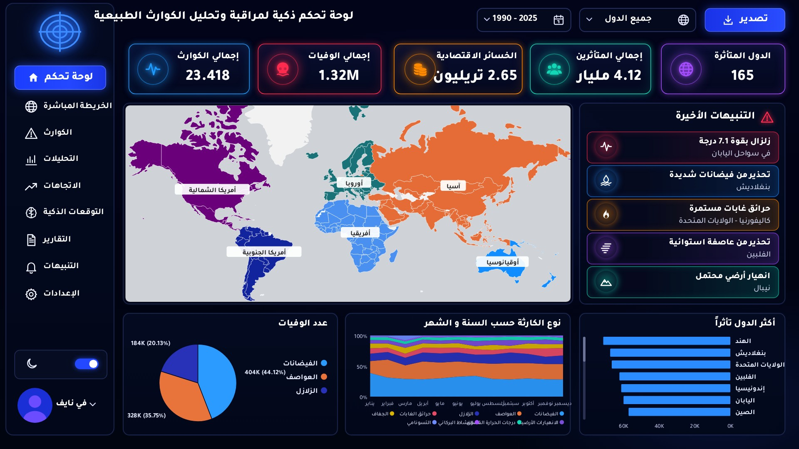

<h1 align="center">Natural Disasters Dashboard</h1>

<p align="center">
  A one-page Power BI dashboard on natural disasters worldwide (1990–2025): how many happened, where, and what they cost in lives, people affected and economic losses.
</p>

<p align="center">
  
  
  
  
</p>

<p align="center">
  
</p>

## Objectives

- Summarise global disaster activity in five KPIs: disasters, deaths, economic losses, people affected and countries affected.
- Show where disasters happen on a world map coloured by continent.
- Compare disaster types and follow the trend over the years.
- Let the user filter by year, continent, country and disaster type.

## Dataset

`data/Natural_Disasters_Clean_AR.zip` contains `Natural_Disasters_Clean_AR.csv` — 23,418 records from 1990 to 2025 across 165 countries. **The data is simulated** (`Data_Status = Simulated`) and is used for practice, not as real disaster statistics.

| Column | Description |
| --- | --- |
| Disaster_ID, Date, Year, Month | Event identifier and date |
| Country, Continent | Location |
| Disaster_Type | Flood, Storm, Earthquake, Wildfire, Landslide, Drought, Extreme temperature, Volcanic activity, Tsunami |
| Deaths, People_Affected, Economic_Loss_USD | Impact |
| Country_AR, Continent_AR, Disaster_Type_AR, Month_AR | Arabic labels used in the report |

The continent and the Arabic labels are added in Power Query, so the report is fully in Arabic.

## Headline figures

| KPI | Value |
| --- | ---: |
| Disasters | 23,418 |
| Deaths | 1.32M |
| Economic losses | $2.65 trillion |
| People affected | 4.12 billion |
| Countries affected | 165 |

Floods (7,075) and storms (5,944) are the most frequent types and also cause the most deaths; Asia has the most events (9,365).

## Key measures

The semantic model contains 11 DAX measures; the full list is in [`dax/DAX-measures.dax`](dax/DAX-measures.dax). Besides the base totals, text measures format the KPI cards in Arabic units (مليون، مليار، تريليون), and a colour measure drives the continent colours on the map.

```dax
Total Disasters = COUNTROWS ( 'Disasters' )

Affected Countries = DISTINCTCOUNT ( 'Disasters'[Country] )
```

## Tools

- **Power BI Desktop** — report, semantic model, Azure Map visual and a custom dark theme
- **DAX** — measures and formatted KPI text
- **Power Query (M)** — continent mapping and Arabic labels
- **Page design** — a 1920×1080 background image for the layout

## Project structure

```
Natural-Disasters-Dashboard/
├── dashboard/
│   ├── Natural_Disasters_Dashboard.pbip              # open this in Power BI Desktop
│   ├── Natural_Disasters_Dashboard.Report/           # report page and visuals
│   ├── Natural_Disasters_Dashboard.SemanticModel/    # data model, Power Query, DAX
│   ├── Natural_Disasters_Theme.json                  # Power BI theme
│   └── page-design/background_1920x1080.png          # page background
├── dax/
│   └── DAX-measures.dax
├── data/
│   └── Natural_Disasters_Clean_AR.zip
├── screenshots/
│   └── dashboard.jpg
├── README.md
└── README_AR.md
```

## How to open

1. Clone the repository or download it as a ZIP and extract it (do not open files from inside the ZIP).
2. Open `dashboard/Natural_Disasters_Dashboard.pbip` in a recent version of Power BI Desktop.
3. Click **Home → Refresh**. The data is embedded in the model, so the report works without moving any file.
4. To read from the CSV directly, extract `data/Natural_Disasters_Clean_AR.zip` and set **Transform data → Edit parameters → FilePath** to the CSV's full path, then refresh.
5. If the map is empty, enable **File → Options → Security → Map and Filled Map visuals** and reopen the file.

To keep a single file, use **File → Save as → Power BI file (.pbix)**.

## نبذة بالعربي

داشبورد Power BI من صفحة وحدة بالعربي للكوارث الطبيعية حول العالم (1990–2025): عدد الكوارث، الوفيات، الخسائر الاقتصادية، المتأثرين والدول، مع خريطة حسب القارة. البيانات محاكاة (Simulated) وليست إحصائيات حقيقية. التفاصيل في [README_AR.md](README_AR.md).

---

<p align="center"><b>Author:</b> Fay Naif · <a href="https://github.com/fay-naif">GitHub</a> · <a href="https://www.linkedin.com/in/fay-naif-4295663b7">LinkedIn</a></p>
