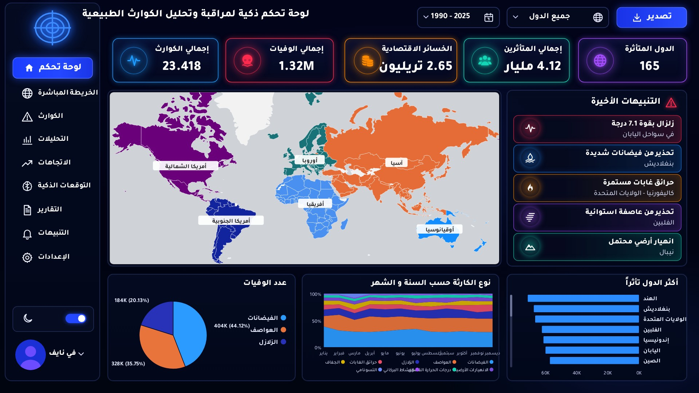

# داشبورد الكوارث الطبيعية

داشبورد Power BI من صفحة وحدة بالعربي يعرض الكوارث الطبيعية حول العالم من 1990 إلى 2025.

  

## الأهداف

- تلخيص الكوارث في خمس بطاقات: عدد الكوارث، الوفيات، الخسائر الاقتصادية، المتأثرين، الدول المتأثرة.
- عرض أماكن الكوارث على خريطة ملوّنة حسب القارة.
- مقارنة أنواع الكوارث ومتابعة الاتجاه عبر السنوات.
- فلاتر حسب السنة والقارة والدولة ونوع الكارثة.

## البيانات

`data/Natural_Disasters_Clean_AR.zip` فيه ملف CSV بـ 23,418 سجل من 1990 إلى 2025 في 165 دولة. **البيانات محاكاة (Simulated)** للتدريب وليست إحصائيات حقيقية. القارة والأسماء العربية (الدول، نوع الكارثة، الأشهر) تنضاف في Power Query.

## أهم الأرقام

| المؤشر | القيمة |
| --- | ---: |
| إجمالي الكوارث | 23,418 |
| إجمالي الوفيات | 1.32 مليون |
| الخسائر الاقتصادية | 2.65 تريليون دولار |
| إجمالي المتأثرين | 4.12 مليار |
| الدول المتأثرة | 165 |

الفيضانات (7,075) والعواصف (5,944) أكثر الأنواع تكراراً وأكثرها وفيات، وآسيا فيها أكثر عدد كوارث (9,365).

## طريقة الفتح

1. نزّلي المستودع كـ ZIP وفكّي الضغط.
2. افتحي `dashboard/Natural_Disasters_Dashboard.pbip` في Power BI Desktop.
3. اضغطي **Home → Refresh**.
4. لو الخريطة فاضية: File → Options → Security → فعّلي Map and Filled Map visuals ثم أعيدي الفتح.

## الأدوات

Power BI Desktop · DAX · Power Query · Azure Map

---

**إعداد:** في نايف · [GitHub](https://github.com/fay-naif) · [LinkedIn](https://www.linkedin.com/in/fay-naif-4295663b7)

